# Research: Mutation Layer for Campaign Entities

## Destination

A single **write implementation** for campaign entities that is reachable from both
the DM-facing web app and the agent/MCP path, reuses the server-side Supabase
client and the RBAC predicates the read path already applies, revalidates the
affected detail/directory routes, and supports a **two-phase write** — propose a
draft, then promote it to live — because the chat surface proposes drafts that a
human approves before they reach the entity tables.

## Recommendation

1. **Server Actions are the write layer for the web app.** A `"use server"` module
   holds thin actions that delegate to a `server-only` **Data Access Layer** in
   `src/server/cms/`. Route Handlers stay reserved for the agent/streaming surface
   and webhooks, not for the app's own mutations.
2. **One write *implementation*, two write *entry points*.** Both the Server
   Actions and the MCP tools call the same DAL functions. The app must **not** call
   the MCP bridge as an HTTP API, and the MCP bridge must **not** be the place the
   app's write rules live.
3. **Drafts live in a new `public.drafts` staging table**, and promotion runs
   through one Postgres function, `public.promote_draft(uuid)`, invoked via
   `.rpc()`. No `status` column is added to the entity tables, so the read path and
   its RBAC are untouched.
4. **Write authorization reuses the read predicates, extracted into one module.**
   Because the app's reads go through a service-role client, RLS is *not* the read
   gate today; the TypeScript predicate is. The write layer must call the same
   predicate, plus the `stripSecrets` field filter for player-facing writes.
5. **Revalidation is `revalidatePath` on the literal entity path plus its
   directory**, called inside the promote action. There is no tagged cache in this
   repo, so `revalidateTag` has nothing to target.

## Why

### Server Actions over Route Handlers for app-originated writes

Both can call `revalidatePath`, but they behave differently, and the difference is
exactly the shape this ticket needs (promote → show the promoted thing):

| Concern | Server Action | Route Handler |
| --- | --- | --- |
| Cache/UI after the write | Runs the action, re-renders the current route, and returns **both** the return value and the new RSC payload in one HTTP roundtrip | `revalidatePath` **"marks the path for revalidation. The revalidation is done on the next visit"** — no re-render of the caller in the response |
| Progressive enhancement | Server Components support it by default: "forms that call Server Actions will be submitted even if JavaScript hasn't loaded yet or is disabled" | You build the client fetch, the pending state, and the no-JS story yourself |
| Invoking from the existing UI | Import from a `"use server"` file; callable from a Client Component's `action`/`formAction`, or directly from an event handler | `fetch()` plus your own error/refresh plumbing |
| Bypassing the UI | Reachable by direct `POST`; must auth inside | Public endpoint by design; must auth inside |
| Fit for streaming / non-UI | Not intended for it | The documented home for streaming (which the agent loop already chose) |

This repo's whole UI is client components (`layout.tsx`, `dashboard/page.tsx`, and
every `src/components/**` primitive carry `"use client"`), while the entity pages
are async Server Components that read data at request time
(`src/app/characters/page.tsx` → `getEntities`). Server Actions drop into that
split without inventing a client-side data layer: the action is imported into the
existing client components, and the re-render is guaranteed by the framework
rather than by a hand-rolled `router.refresh()`.

Route Handlers remain the right tool for the two things they are already better
at here: **streaming to the chat surface** (the sibling agent-loop ticket's Node
route handler) and **non-UI/webhook responses**. They are a poor fit for the
approve button because the caller then needs its own roundtrip and refresh.

Both surfaces are equally exposed, and the docs are explicit that this is not a
reason to prefer one: "Server Functions are reachable via direct POST requests,
not just through your application's UI. Always verify authentication and
authorization inside every Server Function." And on the route-handler side: "Route
Handlers are public HTTP endpoints. Any client can access them." Neither is safer;
both must re-authorize.

### One write implementation, two entry points — not "one write surface"

The ticket asks whether to extend the MCP bridge as a *single* write surface. The
answer is to unify the **implementation**, not the **entry point**, for three
concrete reasons:

1. **The bridge is not importable as a library.** `src/server/mcp/oracle-db.ts`
   constructs a `Server` and calls `server.connect(new StdioServerTransport())` at
   module scope. Importing that module from a route handler or action starts a
   stdio server as a side effect. It is a process entry point, not an adapter.
2. **The bridge is stdio, not HTTP.** It is reachable over a local stdio transport,
   which is why it works for an in-editor agent. Making the web app depend on it
   means adding an HTTP transport and a second network hop for a write that is
   already in-process.
3. **The MCP tool schema is model-shaped, not app-shaped.** The tool arguments are
   `{ model: string, data: object }` where `model` is a bare table name. That is
   the right shape for an LLM choosing a table; it is the wrong shape for the app's
   own writes, which should validate per-entity fields and derive identity from the
   session. The Next.js security guidance is directly on point: "a client
   legitimately tells the server *which* item to act on, but it should not supply
   the row's contents or ownership."

So the seam is:

```mermaid
flowchart TD
    A[Server Action<br/>propose / promote] --> D[DAL<br/>src/server/cms]
    B[MCP tool<br/>propose_* / promote] --> D
    D --> E[supabaseAdmin<br/>service-role]
    D --> F[promote_draft&#40;&#41;<br/>SQL function via rpc]
    F --> G[entity tables]
```



The DAL plus the `promote_draft` SQL function is the **one write implementation**.
Server Actions and MCP tools are both thin wrappers over it. Parity is preserved
because a rule change lands in one place; coupling is avoided because neither
entry point imports the other.

Note the corollary for the agent path: the sibling "Human-in-the-Loop AI Authoring
Surface" ticket decided the agent gets **read-only tools plus `propose_*` only**.
That decision composes cleanly here — `propose_*` is a DAL call that writes a draft
row and never touches an entity table, so the agent never needs a promotion tool.
Promotion stays a human action in the web app.

### Where drafts live, and how promotion is atomic

Recommendation: a **staging table** (`public.drafts`) with the promotion step in a
**Postgres function**.

| Shape | Verdict |
| --- | --- |
| **Staging table `public.drafts` + `promote_draft()` RPC** | **Recommended.** One table serves all entity types, so the approval UI and `propose_*` are entity-agnostic. The read path never learns about drafts, so an unapproved draft cannot leak to a player. Promotion is one function call → one transaction. Durable and reviewable independently of the chat session. |
| `status` column on every entity table | Rejected. Touches ~11 tables (`characters`, `locations`, `factions`, `items`, `religions`, `players`, `campaign_logs`, `world_lore`, `puzzles`, `quest_hooks`, `entities`). Every read filter (`getEntities`, `getEntity`, `getStoryLog`, `getLoreEntries`) and every existing RLS policy would have to learn to exclude drafts — the exact class of change that leaks unapproved content. |
| Separate `drafts` schema | Rejected. Supabase only exposes the schemas you list, so this adds API configuration for no benefit; `public` is the schema every existing table already uses. |
| JSON column on an entity | Rejected. A draft has no entity row yet (the `create` case), so there is nothing to hang it on. |

Concrete shape:

```sql
-- supabase/migrations/<ts>_create_drafts.sql
create table public.drafts (
  id          uuid primary key default gen_random_uuid(),
  kind        text not null check (kind in ('create', 'update', 'delete')),
  model       text not null,
  target_id   uuid,                          -- required when kind in ('update','delete')
  payload     jsonb not null default '{}'::jsonb,
  status      text not null default 'pending'
                check (status in ('pending', 'promoted', 'discarded')),
  origin      text not null default 'web'
                check (origin in ('web', 'agent', 'mcp')),
  created_by  uuid references public.profiles(id),
  created_at  timestamptz not null default now(),
  decided_by  uuid references public.profiles(id),
  decided_at  timestamptz,
  result_id   uuid,                          -- id of the row created/updated
  error       text,
  check (kind = 'create' or target_id is not null)
);

create index drafts_status_created_at_idx
  on public.drafts (status, created_at desc);

alter table public.drafts enable row level security;
```

The atomic promote:

```sql
-- Phase 2, one transaction.
create or replace function public.promote_draft(p_draft_id uuid)
returns uuid
language plpgsql
security invoker
as $$
declare
  d public.drafts;
  new_id uuid;
begin
  select * into d from public.drafts
    where id = p_draft_id
    for update;                       -- serialises concurrent promotes

  if not found then
    raise exception 'draft % not found', p_draft_id;
  end if;
  if d.status <> 'pending' then       -- idempotency guard
    raise exception 'draft % is already %', p_draft_id, d.status;
  end if;

  if d.kind = 'create' then
    insert into public.<resolved dynamically or per-branch>
    ...
  end if;

  update public.drafts
     set status = 'promoted', decided_at = now(), result_id = new_id
   where id = d.id;

  return new_id;
end;
$$;

revoke execute on function public.promote_draft(uuid) from public, anon;
grant execute on function public.promote_draft(uuid) to authenticated, service_role;
```

Two properties matter:

- **Phase 1 (draft) and phase 2 (promote) are separate commits.** A draft that is
  never approved leaves the entity tables untouched.
- **Promotion is one transaction**, because the whole function body runs in one
  statement's transaction. `select ... for update` plus the `status <> 'pending'`
  check makes double-promotion fail loudly instead of duplicating a row. This is
  the piece `SupabaseRecordManager` cannot give you: `createRecord` /
  `updateRecord` / `deleteRecord` are three independent `.insert`/`.update`/
  `.delete` round trips with no transaction spanning them.

`promote_draft` is deliberately `security invoker`, not `security definer`. The
Supabase guidance is to prefer `invoker` and to be wary of `definer`: a `definer`
function created by a migration is owned by `postgres`, which bypasses RLS, and
"any role can call it by default, including `anon`". Keeping it `invoker` means the
caller's own role and policies still apply, and the execute grant keeps `anon` out.

### What "must not bypass the RLS/visibility rules established for reads" means here

This constraint needs restating against what the repo actually does, because RLS is
**not** currently the read gate:

- Reads go through `supabaseAdmin` (`src/server/supabase.ts`), a **service-role**
  client. Supabase's own wording: a secret/service key "authorizes access through
  the `service_role` Postgres role, which has the `bypassrls` attribute", and
  "Policies never apply to a secret key." So every existing read bypasses RLS by
  construction.
- The real read gate is TypeScript: `getEntity` computes
  `entity.visibility === "public" || entity.owner_id === userId` (with
  `role === "DM"` short-circuiting), and `stripSecrets` deletes the per-type
  `secretField` plus `metadata.dm_notes` before a player sees an entity.
  `getEntities`, `getStoryLog`, and `getLoreEntries` each re-implement the same
  visibility rule.
- The migrations do define RLS, but those policies key on
  `(select role from public.profiles where id = auth.uid()) = 'ADMIN'` and on
  `campaign_members.role = 'DM'` — while the TypeScript predicate keys on
  `role === "DM"` and ignores campaigns entirely. Two RBAC definitions already
  diverge, and the TS one is the one that runs.

So "don't bypass the read rules" resolves to: **the write layer must call the same
TypeScript predicate the read layer calls.** Concretely, extract the predicate into
one module (e.g. `src/server/rbac.ts`) exposing `canView(role, userId, entity)` and
`canMutate(role, userId, entity)`, have `getEntity`/`getEntities`/`getStoryLog`
consume it, and have the write DAL consume it too. Right now the predicate is
inlined in at least three places, so a write path that copies it a fourth time is
guaranteed to drift.

There is a second option worth recording, because Supabase documents it: the
service-role client can be made **RLS-enforcing** by attaching the user's access
token — "A secret key bypasses RLS only when the request carries no user access
token. If the request carries one, it runs under the RLS policies of that signed-in
user, even when the client library was initialized with a secret key." That would
let the existing `characters`/`locations`/`factions` policies do the work instead
of TypeScript. It is **not** recommended for v1 only because the RLS policies and
the TS predicate disagree today (ADMIN vs DM, campaign-membership vs none), so
adopting it means first reconciling the two — a separate, larger decision. Flagged
below as a new decision for the map.

### Revalidation

The repo has no tagged cache: no `fetch(..., { next: { tags } })` and no
`'use cache'`, and no `export const revalidate` anywhere. Supabase reads are JS SDK
calls, which are not Next's tagged `fetch`. Therefore **`revalidateTag` has nothing
to invalidate, and `revalidatePath` is the correct primitive.** (Also note: the
single-argument `revalidateTag(tag)` form is deprecated; the two-argument form needs
a cache profile, which again presumes a tagged cache.)

The affected routes are per entity type, and the mapping is direct because the
detail route is literal once you have the id:

```ts
"use server"
import { revalidatePath } from "next/cache"

export async function promoteDraftAction(draftId: string) {
  const { role, userId } = await requireSession()        // see open questions
  const { model, resultId } = await promoteDraft(draftId, { role, userId })

  revalidatePath(`/${model}`)              // directory landing
  revalidatePath(`/${model}/${resultId}`)  // detail page (literal path, no `type`)
}
```

Two documented details drive the shape:

- Use the **literal** path when you have the id; the `type: 'page' | 'layout'`
  argument is required only when the path contains a dynamic segment.
- Because this runs inside a Server Action, the re-render of the current route ships
  in the same response — the DM sees the promoted entity without a second request.
  A Route Handler doing the same thing would only mark the path for the next visit.

The promotion is exposed, in the sense that a route that was already statically
generated would refresh on next visit. In practice these routes are dynamic (the
directory reads `searchParams`, the detail reads `params`), so the action-time
re-render is the effect that matters.

## The three options against the ticket's constraints

| Constraint | Server Actions | Route Handlers | Extend the MCP bridge |
| --- | --- | --- | --- |
| Reuse the service-role client and RBAC helpers | Yes — imports `supabaseAdmin` + the DAL directly | Yes — same imports | Only via a new HTTP transport; the bridge is stdio-only, and importing it boots a server at module scope |
| Must not bypass read visibility | Achievable: action delegates to the DAL that calls the shared predicate | Same | Depends on the bridge's own logic; the app's read predicate isn't reachable from the bridge's process |
| Parity with the agent/MCP path | Shares the DAL with the MCP tools | Shares the DAL | This *is* the parity play, but at the cost of coupling the app to a model-shaped tool schema |
| Revalidation of detail/directory | Built in: re-render in the same roundtrip, plus `revalidatePath` | `revalidatePath` allowed, but invalidation happens on next visit; caller needs its own refresh | No route to the Next cache at all — the bridge runs outside the Next server, so the app would show stale data until a re-read |
| Two-phase write (draft → promote) | Natural: `propose` action + `promote` action, both thin DAL calls | Workable, but the approve step needs a client fetch plus a separate refresh | Drafts would live in the bridge's world; the human approval roundtrip has no cache/UI story |
| Streaming / non-UI responses | Not intended | Yes (the agent loop's choice) | Yes (stdio to the editor agent) |
| Progressive enhancement for the approve step | Yes, by default in Server Components | No | N/A |
| New dependencies | None | None | An HTTP MCP transport (new) |

**Verdict:** Server Actions for the app; Route Handlers where streaming is the
point; the MCP bridge kept as an entry point over the same DAL rather than promoted
to the app's backend.

## What the repo actually contains

| Fact | Evidence |
| --- | --- |
| No Server Action convention exists yet | `grep "use server"` → 0 matches |
| No Route Handlers exist yet | `src/app/api/` does not exist |
| The UI is client components; the entity pages are Server Components | `"use client"` in `layout.tsx`, `dashboard/page.tsx`, `page.tsx`, `components/**`; `src/app/characters/page.tsx` and `src/app/characters/[id]/page.tsx` are async server components |
| Reads are service-role + TypeScript RBAC | `src/server/supabase.ts`, `src/server/entities.ts`, `src/server/story-log.ts`, `src/server/lore.ts` |
| The write adapter is decoupled from the transport | `src/server/cms/adapters/supabase-record-manager.ts` takes a `SupabaseClient` in its constructor |
| The write adapter has no transactions | `createRecord`/`updateRecord`/`deleteRecord` are single PostgREST calls |
| The only write caller is the MCP bridge | `src/server/mcp/oracle-db.ts` is the sole importer of `SupabaseRecordManager` |
| The bridge is a stdio process with import-time side effects | `new StdioServerTransport()` + `server.connect(transport)` at module scope |
| A second privileged client exists for the bridge | `src/utils/supabase-mcp.ts` (`createMCPClient`, loads `.env.local` via `dotenv`) |
| Errors: reads swallow, writes throw | reads do `if (error) return []` / `console.error`; `SupabaseRecordManager` does `if (error) throw error` |
| Session is a prototype stub, overridable by URL | `src/server/session.ts` — `getSession(roleOverride)` reads `?role=PLAYER`; `PROTOTYPE_USER_ID` is hard-coded |
| No RLS on the read path is *enforced* | `supabaseAdmin` is service-role; RLS policies exist but are bypassed |
| RLS policies and TS RBAC disagree | migrations key on `profiles.role = 'ADMIN'` / `campaign_members.role = 'DM'`; TS keys on `role === "DM"` and ignores campaigns |
| Migrations are plain SQL applied in filename order, one transaction each | `supabase/migrations/*.sql`, `src/server/scripts/run-migrations.ts` |
| The migration runner is not wired into `package.json` | `scripts` has only `dev`/`build`/`start`/`test`; `tsx` is a dependency |
| No `next.config.*` | Absent from the repo root |
| No `zod`, no `@supabase/ssr`, no `server-only` | `package.json` |

## Facts that would change the decision, or that need new tickets

1. **The read gate is TypeScript, not RLS.** Any statement of the form "the write
   layer must not bypass RLS" is currently false as written, because nothing on the
   read path is subject to RLS. This is arguably its own ticket: *reconcile RLS
   policies with the TypeScript predicate*, or *adopt RLS as the enforced gate*.
   Until that lands, the write layer's authorization is a code review issue, not a
   database guarantee.
2. **`role` is client-controlled.** `getSession` accepts a `?role=PLAYER` override,
   and `role` also flows through `searchParams` into the entity pages. A Server
   Action must not read role or identity from `FormData`, props, or `searchParams` —
   the docs say to "Read authentication from cookies or headers rather than
   accepting tokens as function parameters." Any action added while the prototype
   session stands inherits this. **New ticket:** the real session source for
   Server Actions (the auth-flow research's `profiles.role`, or a stopgap).
3. **The prototype has one hard-coded user and a second, distinct player id.**
   Draft ownership (`drafts.created_by`) needs a real profile id to mean anything.
4. **`drafts` needs a decision about who may see and approve a draft.** A DM-only
   surface is the assumption here, but a per-campaign DM role exists in the
   `campaign_members` table and is not reflected in the TS predicate. **New
   ticket:** define draft visibility/approval authority.
5. **`promote_draft` must resolve `model` → table safely.** The draft carries a
   `model` string (model-shaped, inherited from the MCP schema). The function needs
   an explicit allowlist branch per entity type; building SQL from `d.model` would
   be an injection path. This is a concrete implementation constraint, not a
   design choice.
6. **Field-level rules for `update` payloads are undefined.** `stripSecrets` governs
   reads. Whether a player may `update` a `secret`/`private` entity, and whether a
   promote may set `visibility`/`owner_id`/`campaign_id`, is not answered by the
   read rule and needs its own answer.
7. **Realtime is unaddressed.** Two-phase writes plus a chat surface invite a
   second DM session seeing stale drafts. Out of scope here, but worth a ticket if
   the map wants live approval queues.
8. **`@supabase/ssr` is not installed.** It is only needed if the recommended
   user-scoped-client option (or real Supabase Auth) is adopted.
9. **The entity tables carry `updated_at` triggers** (`handle_updated_at` on
   characters/locations/factions). A promote that runs as `service_role` will fire
   them; a promote running as `authenticated` under RLS needs a matching `update`
   policy. Worth confirming when the RLS reconciliation ticket is picked up.

## Primary sources

- Next.js — Mutating Data: https://nextjs.org/docs/app/getting-started/mutating-data
  (Server Functions; "Server Functions are reachable via direct POST requests… Always
  verify authentication and authorization"; progressive enhancement in Server
  Components; `revalidatePath`/`redirect` after a mutation)
- Next.js — Server Actions and Mutations: https://nextjs.org/docs/app/guides/server-actions
  (single response carrying data + UI; sequential dispatch; CSRF/origin check; body
  size limit; encrypted action IDs; the `completeItem` vs `completeItemUnsafe`
  ownership example; `updateTag` vs `revalidateTag` vs `revalidatePath` vs `refresh`)
- Next.js — Data Security: https://nextjs.org/docs/app/guides/data-security
  (Data Access Layer; `server-only`; validate client input; re-authorize inside the
  action; control return values; secret keys only in the DAL)
- Next.js — `use server`: https://nextjs.org/docs/app/api-reference/directives/use-server
  (file-level vs inline directive; importing into Client Components; auth from
  cookies/headers, not parameters; constrain return values)
- Next.js — `revalidatePath`: https://nextjs.org/docs/app/api-reference/functions/revalidatePath
  ("Route Handlers: Marks the path for revalidation. The revalidation is done on the
  next visit"; literal path vs route pattern + `type`)
- Next.js — `revalidateTag`: https://nextjs.org/docs/app/api-reference/functions/revalidateTag
  (tags must first be assigned via `fetch` tags or `cacheTag`; single-argument form
  deprecated; `{ expire: 0 }` for out-of-action callers)
- Next.js — Forms: https://nextjs.org/docs/app/guides/forms
  (`action`/`formAction`, `bind`, `useActionState`, `useFormStatus`, `useOptimistic`,
  nested `formAction` for a draft-vs-publish pair)
- Next.js — route.js: https://nextjs.org/docs/app/api-reference/file-conventions/route
  (Web `Request`/`Response`, HTTP methods, streaming used with LLM SDKs, `runtime`)
- Next.js — Backend for Frontend: https://nextjs.org/docs/app/guides/backend-for-frontend
  ("Route Handlers are public HTTP endpoints. Any client can access them"; perform
  auth checks; "Server Actions are queued. Using them for data fetching introduces
  sequential execution")
- Supabase — Row Level Security: https://supabase.com/docs/guides/database/postgres/row-level-security
  (policies vs grants; `anon`/`authenticated`/`service_role`; "Use a secret key for
  administrative tasks that need to bypass RLS… `service_role`… has the `bypassrls`
  attribute"; prefer `security invoker`; pin `search_path` on `definer`; grant
  execute narrowly)
- Supabase — API keys: https://supabase.com/docs/guides/api/api-keys
  (key → Postgres role table; "Policies never apply to a secret key"; "A secret key
  bypasses RLS only when the request carries no user access token")
- Supabase — Database functions: https://supabase.com/docs/guides/database/functions
  (`create or replace function`, `language plpgsql`, calling from JS with `rpc()`,
  `security definer` vs `invoker`, function privileges)

## Open questions

- **Session source for Server Actions.** `requireSession()` above assumes a
  server-readable role. Today `getSession` is a stub with a `?role=` override. Which
  ticket owns the real one, and does the mutation layer wait for it or ship behind a
  DM-only check?
- **Does promotion need an audit trail beyond `drafts`?** The staging row records
  `created_by`/`decided_by`/`decided_at`, but a promoted change leaves no history on
  the entity itself. If the map wants reversibility, that is a separate design
  (the sibling "story log" surface may be the intended place).
- **Does the agent need a `propose_update` target, or only `propose_record`?** The
  agent-loop ticket lists `propose_record`/`propose_update`/`propose_delete`. The
  draft table supports all three, but whether the v1 chat surface exposes delete is
  a product call.
- **Should the MCP bridge gain `propose_*`/`promote` tools at all**, or should the
  editor agent keep calling `create_record` directly? If the bridge keeps
  `create_record`, there are two write *policies* even with one implementation —
  agents can bypass the approval step that humans cannot. Worth an explicit decision,
  because the sibling map's whole premise is that the agent proposes and a human
  approves.
- **Does `promote_draft` belong in `public`?** Putting it in an unexposed schema and
  calling it from a `security definer` wrapper is the more defensive option; the
  recommendation keeps it `invoker` in `public` for simplicity, which accepts that
  it is callable by `authenticated` and returns a row id.
- **Question of `stripSecrets` on write.** Should an `update` draft be allowed to
  set `secrets`/`metadata.dm_notes` at all when the promoter is not a DM? The
  read-side mirror of that filter exists; the write-side one does not.
- **Where does the drafts approval UI live** — a DM-only `/drafts` route, or inline
  in the chat surface that produced the draft? That choice determines whether the
  promote action is a form action on a list page or an event handler in the chat
  component.
